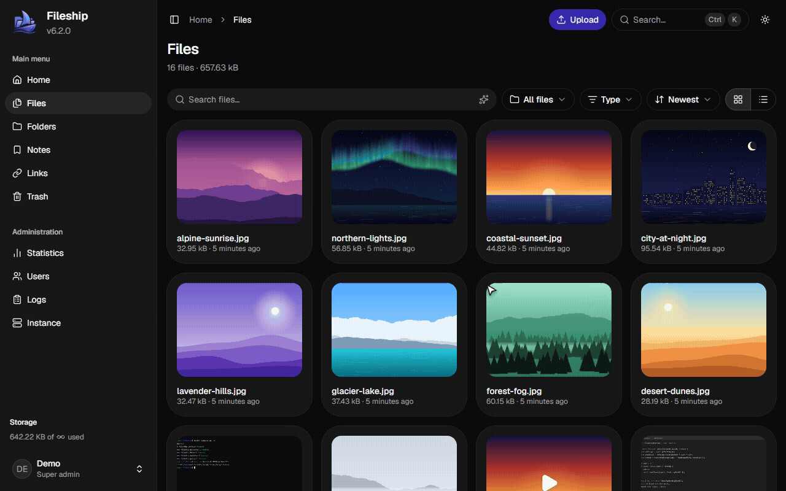

<div align="center">
  <a href="https://github.com/hanzydev/Fileship">
    
  </a>

  <p align="center">
    Tu propio servidor de ShareX y tu nube de archivos: una app nativa para Windows, sincronización con el Explorador de archivos, búsqueda con IA que se ejecuta en tu servidor y una extensión para el navegador.
    <br />
    <br />
    <a href="https://github.com/hanzydev/fileship-desktop/releases/latest">Descargar para Windows</a>
    ·
    <a href="https://github.com/hanzydev/Fileship/issues/new?template=bug-report.yml">Informar de un error</a>
    ·
    <a href="https://github.com/hanzydev/Fileship/issues/new?template=feature-request.yml">Proponer una función</a>
    ·
    <a href="SECURITY.md">Política de seguridad</a>
  </p>

  <p align="center">
    <a href="README.md">English</a> · <a href="README.tr.md">Türkçe</a> · <a href="README.de.md">Deutsch</a> · <b>Español</b> · <a href="README.fr.md">Français</a> · <a href="README.it.md">Italiano</a> · <a href="README.pt-BR.md">Português (Brasil)</a> · <a href="README.ru.md">Русский</a> · <a href="README.az.md">Azərbaycanca</a> · <a href="README.ja.md">日本語</a> · <a href="README.ko.md">한국어</a> · <a href="README.zh-CN.md">简体中文</a>
  </p>
</div>

<p align="center">
  
</p>

## 📦 Funciones

- Archivos, carpetas anidadas que puedes compartir con otros usuarios, notas en Markdown, enlaces cortos y buzones, con una papelera para todo lo que eliminas
- Copias de seguridad de la cuenta que puedes descargar y restaurar, creadas a mano o de forma programada
- Uso compartido público con contraseñas, fechas de caducidad, límites de visualizaciones y vistas previas enriquecidas para Discord y otras apps
- [IA](docs/ai.md) que se ejecuta en tu servidor: búsqueda inteligente en más de 50 idiomas, descripciones, OCR y detección de contenido sensible, todo opcional
- Subidas guardadas en el disco local, en cualquier servicio compatible con S3, SFTP o FTP
- Varios usuarios con permisos y límites de almacenamiento, llaves de acceso, verificación en dos pasos e [inicio de sesión único](docs/configuration.md#single-sign-on) con OpenID Connect
- Actualizaciones sin tiempo de inactividad, con un clic o programadas
- Integraciones de subida para ShareX, macOS y Linux, la [app para Windows](docs/desktop.md) y una [app instalable para teléfonos](docs/mobile.md) a la que puedes compartir desde las apps de Android
- Una [extensión para el navegador](docs/browser-extension.md) que sube archivos, imágenes y capturas de pantalla y acorta enlaces, [en Chrome Web Store](https://chromewebstore.google.com/detail/fileship/lbnlfnmlaipoflalhikladilalkoagnh) para Chrome y Edge, y compilada desde el código fuente para Firefox
- [Webhooks](docs/webhooks.md) para Discord, Slack y tus propios servicios
- Inglés, turco, alemán, español, francés, italiano, portugués de Brasil, ruso, azerí, japonés, coreano y chino simplificado

## 🆚 Fileship frente a las alternativas

|                                                             | Fileship                              | [Zipline](https://github.com/diced/zipline) | [XBackBone](https://github.com/sergix44/XBackBone) | [Chibisafe](https://github.com/chibisafe/chibisafe) |
| ----------------------------------------------------------- | ------------------------------------- | ------------------------------------------- | -------------------------------------------------- | --------------------------------------------------- |
| ShareX y otros clientes de subida                           | ✅                                    | ✅                                          | ✅                                                 | ✅                                                  |
| App de escritorio para capturas y grabaciones               | ✅ Windows                            | ❌                                          | ❌                                                 | ❌                                                  |
| Tus archivos en el Explorador de archivos                   | ✅ Fileship Harbor                    | ❌                                          | ❌                                                 | ❌                                                  |
| Extensión para el navegador                                 | ✅                                    | ❌                                          | ❌                                                 | ✅                                                  |
| Búsqueda con IA, descripciones, OCR y contenido sensible    | ✅ en tu servidor                     | ❌                                          | ❌                                                 | ❌                                                  |
| Enlaces cortos                                              | ✅                                    | ✅                                          | ❌                                                 | ✅                                                  |
| Notas o fragmentos de texto                                 | ✅ Markdown                           | ✅                                          | 🟡 subidas de texto                                | ✅                                                  |
| Carpetas                                                    | ✅ anidadas, compartidas con usuarios | ✅ anidadas                                 | ❌ etiquetas                                       | 🟡 álbumes sin anidar                               |
| Contraseñas, caducidad y límites de visualizaciones         | ✅                                    | ✅                                          | ❌                                                 | 🟡 los enlaces de álbum caducan                     |
| Almacenamiento                                              | Local, S3, SFTP, FTP                  | Local, S3                                   | Local, S3, FTP, Dropbox, Google Cloud              | Local, S3                                           |
| Verificación en dos pasos y llaves de acceso                | ✅                                    | ✅                                          | ❌                                                 | ❌                                                  |
| Inicio de sesión único                                      | ✅ OIDC                               | ✅ OAuth, OIDC                              | ✅ LDAP                                            | ❌                                                  |
| Webhooks                                                    | ✅ Discord, Slack, JSON firmado       | ✅ Discord, HTTP                            | ❌                                                 | ❌                                                  |
| Copias de seguridad de la cuenta restaurables y programadas | ✅                                    | 🟡 exportación                              | 🟡 exportación                                     | ❌                                                  |
| Actualizaciones desde el panel                              | ✅ sin tiempo de inactividad          | ❌                                          | 🟡 con tiempo de inactividad                       | ❌                                                  |
| Idiomas                                                     | 12                                    | 12                                          | 31, algunos incompletos                            | 1                                                   |
| Licencia                                                    | MIT                                   | MIT                                         | AGPL-3.0                                           | MIT                                                 |

Comparado con Zipline 4.8, XBackBone 3.8 y Chibisafe 6.7 en octubre de 2026. ¿Hay algo desactualizado? [Abre un issue](https://github.com/hanzydev/Fileship/issues/new/choose) y se corregirá.

## 📸 Capturas de pantalla

<p align="center">
  
  &nbsp;
  
</p>

## 🖥️ Fileship para Windows

Captura, graba y sube contenido a tu Fileship desde el área de notificación, al estilo de ShareX, y explora tus archivos en el Explorador de archivos con Fileship Harbor. Requiere Windows 11 de 64 bits, versión 24H2 o posterior, y un servidor con Fileship 6.0.

**[Descargar la última versión](https://github.com/hanzydev/fileship-desktop/releases/latest)** · [Funciones y configuración](docs/desktop.md)

## 🚀 Primeros pasos

Necesitas [Docker](https://www.docker.com/) con [Docker Compose](https://docs.docker.com/compose/), 2 núcleos de CPU y 2 GB de RAM (4 GB o más con IA; consulta los [requisitos](docs/installation.md#requirements)).

```sh
git clone https://github.com/hanzydev/Fileship.git
cd Fileship
echo "SECRET_TOKEN=$(openssl rand -hex 32)" > .env
docker compose up -d
```

Fileship ya está disponible en `http://localhost:3000`. Inicia sesión con `admin` / `password`.

> [!IMPORTANT]
> Cambia la contraseña justo después de iniciar sesión por primera vez (**Configuración → Seguridad**).

¿Actualizas desde 5.x? Sigue [Actualizar a 6.0](docs/upgrading.md). ¿Vienes de Zipline, XBackBone o Chibisafe? [Trae tus cuentas, archivos y enlaces](docs/migrating.md).

## 📚 Documentación

- [Instalación](docs/installation.md): requisitos, navegadores compatibles y cómo servir Fileship en tu propio dominio
- [Configuración](docs/configuration.md): opciones del servidor, almacenamiento, papelera y variables de entorno
- [Actualizaciones](docs/updating.md): cómo funcionan las actualizaciones y cómo programarlas
- [Migrar desde otra app](docs/migrating.md): importar un servidor de Zipline, XBackBone o Chibisafe
- [Funciones de IA](docs/ai.md): perfiles, modelos, búsqueda inteligente y contenido sensible
- [Fileship para Windows](docs/desktop.md)
- [Fileship en tu teléfono](docs/mobile.md): instalar la app y compartir desde Android
- [Webhooks](docs/webhooks.md): eventos, formatos, entrega y verificación de firmas
- [Telemetría](docs/telemetry.md): qué se recopila y cómo desactivarla

## 🧰 Tecnologías


## ❤️ Contribuir

Las contribuciones son bienvenidas. Lee primero las [pautas de contribución](CONTRIBUTING.md). [AGENTS.md](AGENTS.md) describe la arquitectura y las convenciones del código.

## ⚖️ Licencia

[MIT](LICENSE)
