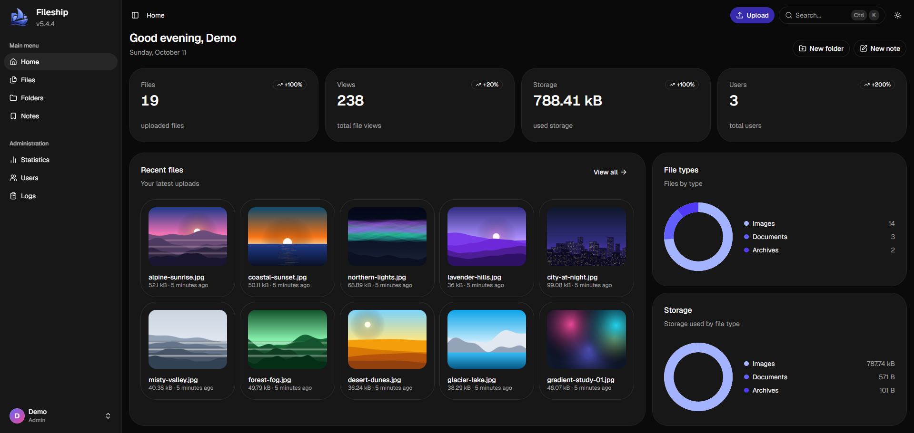
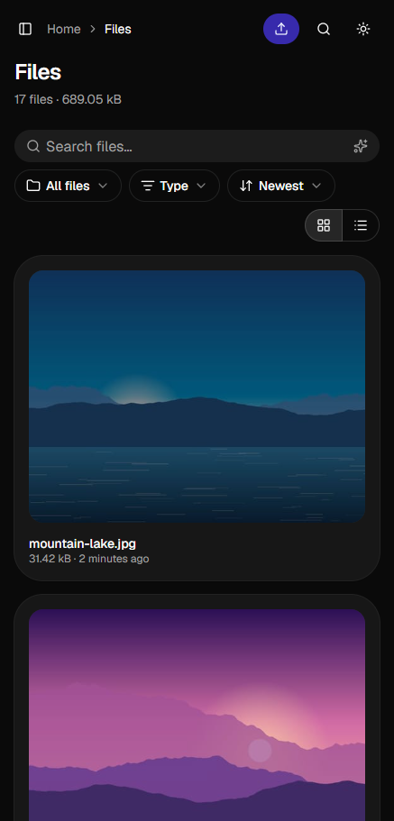

<div align="center">
  <a href="https://github.com/hanzydev/Fileship">
    
  </a>

  <p align="center">
    An open-source, self-hosted file and media management platform.
    <br />
    <br />
    <a href="https://github.com/hanzydev/Fileship/issues/new?template=bug-report.yml">Report a bug</a>
    ·
    <a href="https://github.com/hanzydev/Fileship/issues/new?template=feature-request.yml">Request a feature</a>
    ·
    <a href="SECURITY.md">Security policy</a>
  </p>
</div>

## 📸 Screenshots

<p align="center">
  
  &nbsp;
  
</p>

## 🧰 Built With


## 📦 Features

**Files and sharing**

- Chunked uploads with drag and drop, paste-to-upload and an upload queue
- Folders with cover previews, public sharing and archive downloads; password protected files in a public folder show a lock and open with their password
- Markdown notes with code highlighting, math and public links
- Password protection, expiry dates and view limits for files
- Image compression, EXIF removal, image and video thumbnails, and media details (resolution, duration, frame rate, bitrate, codecs)
- Custom domains and OpenGraph embeds for links shared on Discord and other apps
- Inbox links that let anyone send files straight to your account
- A link shortener with custom short links, passwords, click limits and expiry dates
- A trash that keeps deleted files, folders and notes restorable for a set number of days
- ShareX uploader and URL shortener configs and macOS and Linux scripts, all using a revocable upload token

**Search and AI**

- Smart search in over 50 languages that understands what is in your images, videos and documents
- Image captions, OCR and detection of sensitive content such as contact details, addresses, ID and account numbers, payment cards and secret keys, in any language
- Every model runs locally on your server, and all of it can be turned off

**Accounts and security**

- Multiple users with per-user permissions and storage limits
- Optional self-registration
- Two-factor authentication with authenticator apps and passkeys
- Session management and an audit log
- Cloudflare Turnstile protection for the login and sign up forms
- Personal backups that can be downloaded and restored

**Operations**

- Real-time updates across every open tab and device
- Usage statistics
- Instance settings managed from the dashboard
- Uploads and backups on the local disk, any S3 compatible service, SFTP or FTP
- Zero-downtime updates, one click or on a schedule
- Installable as a Progressive Web App

## 🌐 Browser Compatibility

Fileship targets current versions of Chrome, Edge, Firefox, Brave and Zen Browser. Safari is supported through compatibility fallbacks, but a Chromium- or Firefox-based browser gives the best experience.

## 🚀 Getting Started

### Requirements

|          | AI disabled | AI preset `low` | AI preset `medium` | AI preset `high` |
| -------- | ----------- | --------------- | ------------------ | ---------------- |
| **CPU**  | 2 cores     | 2 cores         | 4 cores            | 4 cores or more  |
| **RAM**  | 2 GB        | 4 GB            | 6 GB               | 8 GB             |
| **Disk** | 4 GB        | 6 GB            | 7 GB               | 7.5 GB           |

The disk sizes include about 1.8, 2.6 and 3 GB of AI models. Add the space for uploaded files kept on the local disk. AI runs on the CPU, so more cores analyze uploads faster; no GPU is needed. Both x86-64 and ARM64 are supported. See [AI presets](#ai-presets) for what each preset does.

You also need [Docker](https://www.docker.com/) and [Docker Compose](https://docs.docker.com/compose/).

PostgreSQL 16 is included in the Compose stack.

### Installation

**1. Clone the repository**

```sh
git clone https://github.com/hanzydev/Fileship.git
cd Fileship
```

**2. Generate the updater secret**

Fileship ships with a small `updater-agent` service that performs updates. Generate the secret it shares with the app:

```sh
echo "SECRET_TOKEN=$(openssl rand -hex 32)" > .env
```

**3. Start Fileship**

```sh
docker compose up -d
```

Fileship is now available at `http://localhost:3000`.

### Default credentials

- Username: `admin`
- Password: `password`

> [!IMPORTANT]
> Change the password right after your first login (**Settings → Security**).

## ⚙️ Configuration

### Instance settings

Super admins can configure Fileship from the dashboard in **Administration → Instance**. The changes apply immediately, without a restart:

- **General:** site name and link protocol
- **Uploads:** chunk size, avatar size limit, trash retention and EXIF removal
- **Registration:** self-registration, default permissions (upload files, take notes, shorten links) and storage limit
- **Turnstile:** site and secret keys
- **AI:** features on or off, concurrency and video processing
- **Logs and telemetry:** log level and anonymous telemetry
- **Storage:** where uploads and backups are kept

Each of these settings can also be given a default through an environment variable (see [`apps/dashboard/.env.example`](apps/dashboard/.env.example)). A value saved in the dashboard always overrides the environment, and every field can be reset to its default.

### Storage

Fileship keeps uploads and backups in its data directory by default. In **Administration → Instance → Storage** you can add S3 compatible storage (AWS S3, Cloudflare R2, MinIO, Backblaze B2 and others), SFTP or FTP, and choose which one new files go to. Each file stays where it was written, so switching storage does not move anything. Use **Move everything here** on the active storage to move existing files and backups to it.

Uploads stream to the storage chunk by chunk. Thumbnails and temporary files always stay in the data directory. Storage credentials are encrypted with `data/secret.key`, so keep that file together with your data.

On every start, Fileship removes files and backups whose data is missing from their storage. A storage that cannot be reached or looks empty is skipped, so a misconfigured storage never deletes anything.

### Trash

Deleted files, folders and notes move to the trash for 30 days by default. Set **Trash retention** in **Administration → Instance** (or `NUXT_TRASH_RETENTION_DAYS`) to change it; `0` deletes everything immediately. Items in the trash still count toward a user's storage limit until they are deleted for good. Expired files and files that reach their view limit are always deleted immediately.

### Environment-only settings

A few settings can only be set through the environment, because they are needed before the dashboard starts or are fixed when the app is built:

| Variable                                      | Description                                                     |
| --------------------------------------------- | --------------------------------------------------------------- |
| `DATABASE_URL`                                | PostgreSQL connection string (required)                         |
| `NUXT_DATA_DIRECTORY`                         | Local storage, thumbnails and temporary files (default: `data`) |
| `NUXT_UPDATER_URL` / `NUXT_UPDATER_SECRET`    | How the dashboard reaches the updater agent                     |
| `DELETE_EXPIRED_CRON` / `GENERATE_STATS_CRON` | Schedules for expired file cleanup and statistics (build time)  |
| `ENABLE_PWA`                                  | Progressive Web App support (build time)                        |

To set an environment variable with Docker Compose, add it to the shared `x-fileship` block in `docker-compose.yml`, so both the `fileship-blue` and `fileship-green` containers receive it:

```yaml
x-fileship: &fileship
    environment:
        NUXT_PUBLIC_REGISTRATION_ENABLED: 'true'
```

Then apply it with `docker compose up -d`.

## 🔄 Updating Fileship

Fileship updates itself without downtime. A small built-in proxy ([Caddy](https://caddyserver.com/)) listens on port `3000` and always routes requests to a healthy container. During an update, the updater agent starts the new version in a second container (`fileship-blue` / `fileship-green`), waits until it is healthy and then stops the old one. If the new version fails to start, it is removed and the current version keeps running. Updates also wait for any running backup restore to finish.

### One-click update

When a new release is available, admins see an update card in the sidebar. Click **Update** to start it and follow its progress live.

### Scheduled updates

Automatic updates are enabled by default and run every day at 3:00 AM. You can change or disable them in `docker-compose.yml`:

```yaml
updater-agent:
    environment:
        AUTOUPDATER_ENABLED: true # set to false to disable scheduled updates
        AUTOUPDATER_CRON: '0 3 * * *' # cron expression (default: every day at 3:00 AM)
```

### ⚠️ Upgrading to 6.0

Fileship 6.0 introduces a redesigned dashboard and renames its environment variables so they can be applied at runtime. Before updating:

**1. Pull the latest project files**, which include the updated `docker-compose.yml`:

```sh
cd Fileship
git pull
```

**2. Rename any of these variables you set yourself:**

| 5.x                    | 6.0                         |
| ---------------------- | --------------------------- |
| `DATA_DIRECTORY`       | `NUXT_DATA_DIRECTORY`       |
| `REMOVE_EXIF_DATA`     | `NUXT_REMOVE_EXIF_DATA`     |
| `AVATAR_MAX_SIZE`      | `NUXT_AVATAR_MAX_SIZE`      |
| `LOG_LEVEL`            | `NUXT_LOG_LEVEL`            |
| `TELEMETRY_ENABLED`    | `NUXT_TELEMETRY_ENABLED`    |
| `UPDATER_URL`          | `NUXT_UPDATER_URL`          |
| `UPDATER_SECRET`       | `NUXT_UPDATER_SECRET`       |
| `AI_PRESET`            | `NUXT_AI_PRESET`            |
| `AI_QUEUE_CONCURRENCY` | `NUXT_AI_QUEUE_CONCURRENCY` |
| `AI_INFERENCE_THREADS` | `NUXT_AI_INFERENCE_THREADS` |
| `AI_JOB_LEASE_MS`      | `NUXT_AI_JOB_LEASE_MS`      |

Most of these can now be managed in **Administration → Instance** instead, so you may not need to set them at all. The upload chunk size must now be at least 5 MB; a smaller `NUXT_PUBLIC_FILE_CHUNK_SIZE` falls back to the default of 25 MB.

**3. Recreate the stack:**

```sh
docker compose pull
docker compose up -d --remove-orphans
```

<details>
<summary><strong>Upgrading from an older 5.x setup</strong></summary>

If your installation predates the updater agent or zero-downtime updates (your `docker-compose.yml` has a single `fileship` service), run the steps above as well. The new `docker-compose.yml` adds the updater agent, the proxy and the two app containers. If you don't have a `.env` file with a `SECRET_TOKEN` yet, create one first:

```sh
echo "SECRET_TOKEN=$(openssl rand -hex 32)" > .env
```

This migration restarts Fileship one last time. Later updates do not.

</details>

## 🌐 Web server configuration (optional)

To serve Fileship on your own domain, put a reverse proxy in front of it. An [Nginx](https://nginx.org/) example:

```nginx
map $http_x_forwarded_proto $the_scheme {
    default $scheme;
    ~. $http_x_forwarded_proto;
}

server {
    listen 80;
    server_name <domain>;

    client_max_body_size 100M;

    proxy_set_header Host $host;
    proxy_set_header X-Real-IP $remote_addr;
    proxy_set_header X-Forwarded-For $proxy_add_x_forwarded_for;

    proxy_set_header X-Forwarded-Proto $the_scheme;

    location / {
        proxy_pass http://127.0.0.1:3000;
    }

    location /socket.io/ {
        proxy_pass http://127.0.0.1:3000;
        proxy_http_version 1.1;
        proxy_set_header Upgrade $http_upgrade;
        proxy_set_header Connection "upgrade";
    }
}
```

Nginx points to `127.0.0.1:3000`, the built-in proxy. WebSocket upgrades and the `X-Forwarded-*` headers pass through, so Fileship still sees the real client IP. The built-in proxy has no upload size limit of its own, so `client_max_body_size` is the only one that applies. Uploads are sent in chunks (25 MB by default), so the limit only needs to be larger than the chunk size.

## 🤖 AI Features

Fileship can analyze uploads to power smart search, image captions, OCR and sensitive content detection. The models run locally with [Transformers.js](https://huggingface.co/docs/transformers.js); no file ever leaves your server.

AI features are **enabled by default**. Super admins can turn them off in **Administration → Instance**, and each user can opt out in their own settings. The `NUXT_PUBLIC_AI_ENABLED` environment variable sets the instance default.

When AI is disabled:

- no new AI jobs are queued or processed
- smart search falls back to full-text search
- AI-related parts of the interface are hidden

Every image, video and text file is analyzed once in the background after it is uploaded. **Parallel jobs** sets how many files are analyzed at the same time and **Threads per job** how many CPU cores each one uses; on small servers keep both low. A job whose server stops responding is picked up again after **Job heartbeat timeout**, and a file that fails three times is left alone until you choose **Retry failed** in the AI section of **Administration → Instance**, which also shows the queue.

### AI presets

The preset sets which models are used and how long they stay in memory. Choose it in **Administration → Instance** or with `NUXT_AI_PRESET`. Changing it analyzes files again in the background where the models differ.

|                        | `low`                          | `medium` (default)                    | `high`                                 |
| ---------------------- | ------------------------------ | ------------------------------------- | -------------------------------------- |
| Image and video search | mSigLIP, compact query encoder | mSigLIP, full precision query encoder | mSigLIP, full precision query encoder  |
| Captions               | short                          | detailed                              | detailed, full precision image encoder |
| OCR                    | PaddleOCR tiny                 | PaddleOCR small                       | PaddleOCR small                        |
| Video frames           | 8                              | 16                                    | 32                                     |
| Models stay loaded for | 2 minutes                      | 5 minutes                             | 15 minutes                             |

### Models

The models are downloaded from Hugging Face the first time they are needed and kept in `data/models`, so updates and both blue/green containers reuse them. To run without internet access, copy that folder from another installation.

| Task                                   | Model                                                                                                                                                                  |
| -------------------------------------- | ---------------------------------------------------------------------------------------------------------------------------------------------------------------------- |
| Image and video search                 | [mSigLIP base](https://huggingface.co/google/siglip-base-patch16-256-multilingual) ([ONNX](https://huggingface.co/pulsejet/siglip-base-patch16-256-multilingual-onnx)) |
| Captions                               | [Florence-2 base](https://huggingface.co/onnx-community/Florence-2-base)                                                                                               |
| OCR                                    | [PaddleOCR PP-OCRv6 and PP-OCRv5 script models](https://github.com/PT-Perkasa-Pilar-Utama/ppu-paddle-ocr)                                                              |
| Search in captions, OCR and text files | [Multilingual MiniLM](https://huggingface.co/Xenova/paraphrase-multilingual-MiniLM-L12-v2)                                                                             |
| Sensitive content                      | [OpenAI Privacy Filter](https://huggingface.co/openai/privacy-filter)                                                                                                  |

The models were chosen by measuring them on 400 images of [Crossmodal-3600](https://google.github.io/crossmodal-3600/) with human captions in English, Turkish, German, Spanish, French, Arabic, Russian, Japanese and Chinese. Compared with v5, the `medium` preset finds the right image first for 76% of non-English queries instead of 58%, and a query that describes nothing in the library returns about 1.5 results instead of 12. OCR reads Latin, Cyrillic, Greek, Thai, Korean, Japanese and Chinese text (Arabic only partly), and no longer invents text on photos that have none.

### Smart search

Smart search combines what images and videos show, what their captions and OCR text say, the content of text files, and file names. Queries work in many languages, so `köpek` finds the same photos as `dog`. Only results that clearly match are shown; a query that matches nothing returns few or no results. While a file is still being analyzed, full-text search already finds it by name.

### Sensitive content

Fileship reads the text of documents and the OCR text of images with the [OpenAI Privacy Filter](https://huggingface.co/openai/privacy-filter) model, which looks at the context instead of fixed patterns, so it works with any country's formats. A file is marked as sensitive when it contains:

- private email addresses, phone numbers or home addresses
- account, ID, tax or social security numbers
- passwords and secret keys
- payment card numbers (checked with the Luhn algorithm), IBANs (checked with their checksum) and the machine-readable lines of passports and ID cards
- photos of payment cards and ID documents that show a number

Public information such as company addresses, support emails, brands and public figures is not sensitive. Faces are not sensitive, and a name or a personal date only counts next to something else, or when they appear together.

Sensitive files are hidden from public folders and their archives, and can be blurred for you with **Hide sensitive previews** in your AI settings. While AI is enabled, images and text files are also kept out of public folders until they have been checked.

If Fileship gets it wrong, choose **Not sensitive** or **Mark as sensitive** from the file's menu. Your choice is kept when the file is checked again.

### Upgrading to v6

v6 replaces the AI models, the OCR engine and the sensitive content rules. On the first start the old embeddings, OCR text and the sensitive flags that no longer apply are removed, and every file is analyzed again in the background while AI is enabled. Full-text search by file name and caption keeps working in the meantime.

## 📊 Telemetry

Fileship collects anonymous usage data to understand how it is used and to guide development. Collection is **optional** and can be turned off at any time.

### What is collected

- **Instance information:** app version, counts of files, folders, notes and users, and the Node.js version
- **System information:** OS platform, release and architecture, CPU count and model, memory and disk usage, and whether Fileship runs in Docker

No personal information, file contents or file names are collected. Each instance is identified only by a random ID. See the [telemetry package](packages/telemetry/README.md) for the full list of fields.

### Opting out

Turn off **Anonymous telemetry** in **Administration → Instance**, or set `NUXT_TELEMETRY_ENABLED` to `false` in the `x-fileship` block of your `docker-compose.yml`.

## ❤️ Contributing

Contributions are welcome. Please read the [contribution guidelines](CONTRIBUTING.md) first. [AGENTS.md](AGENTS.md) describes the architecture and conventions of the codebase.

## ⚖️ License

[MIT](LICENSE)
